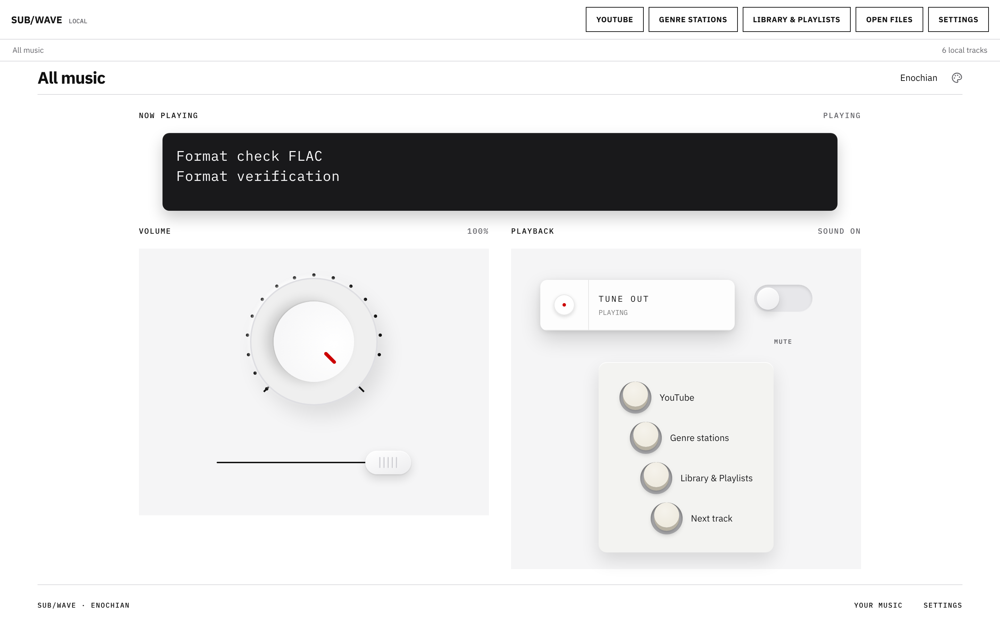
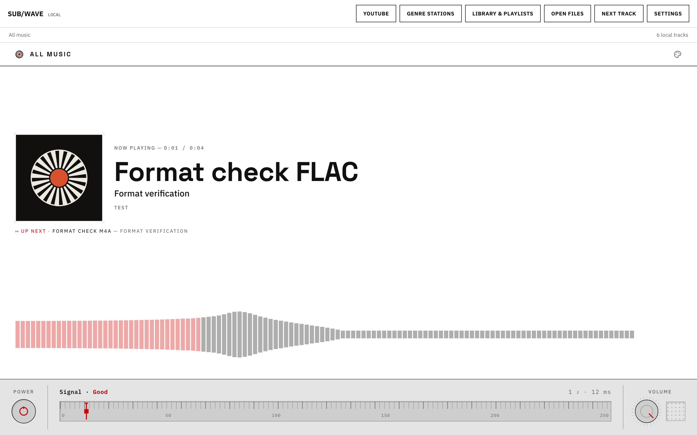

# Subwave for Linux

**Your music, genre radio stations and YouTube downloads in one desktop player.**

Open Subwave from your Linux Apps menu. Its local music service starts with the player. Import audio, build an ordered playlist, or search YouTube and keep an MP3. Choose **Original** or **Enochian** for the player’s appearance.

This desktop edition is developed from [perminder-klair/subwave](https://github.com/perminder-klair/subwave). It starts without an account, admin login, station address, Docker or a separately configured radio server. The inherited web radio and server code remains in the repository; its setup is documented separately in [README.upstream.md](README.upstream.md).

[Owner’s manual](owners_manual.md) · [Desktop build notes](desktop/README.md) · [Enochian source fidelity](docs/enochian-design.md)

## Two skins, one music library

### Enochian

The authored [Enochian Elements](https://uiux-nonhumanintelligence.web.app/UIUX) controls run from their source code: rotary knob, ribbed slider, inset display, AV receiver power control, switches, Input Selector keys and rolling search control. Layout and scale adapt to the app while preserving the controls’ materials, geometry and interaction behavior. Ivory and Obsidian are finishes of the same skin.



### Original

The original Subwave player identity, connected to the same local library, transport and desktop panels. Original has Light and Dark palettes.



These are installed-app captures using an isolated test library. Changing skins preserves the shared audio player and library state.

## Features

| Feature | Behavior |
| --- | --- |
| Local music | Native Linux file chooser, multiple-file import and metadata indexing. Playable MP3 copies preserve your external source files. |
| Supported imports | MP3, FLAC, WAV, M4A and OGG are verified. The chooser also accepts Opus and AAC. Up to 50 files per import, each no larger than 250 MiB. |
| Library | Search title, artist or genre; filter collections; refresh after file changes. |
| Playlists | Create, rename, add/remove tracks, reorder, play in saved order, delete and restore. Playlists repeat after the last track. |
| Genre radio | Independent genre collections. Choose what plays or copy a track to another genre while keeping its original. |
| YouTube | Search by song/artist or paste an individual video URL. Download real MP3s with visible job states and retry. |
| Genre sorting | Match video tags, title and description to genre rules. Unclear matches wait for a manual destination. |
| Recent downloads | Retain original YouTube MP3s after genre copies. Export another copy through the native save dialog. |
| Desktop usability | Native menus, shortcuts, chooser/save dialogs, resizing, zoom and system media controls. |
| Local storage | Music and organization stay on the computer. Existing local music works offline; YouTube needs a connection. |

Initial collections are **Jazz, House, Rock, Ambient and Local files**, plus an **All music** view. Create additional genres up to eight genre stations in total. A genre station is a local listening collection, independent of a YouTube uploader/channel.

## Start listening

On the configured Omarchy installation, open **Subwave** from **Apps**.

1. Open **Library & Playlists**.
2. Choose **Add files to genre**, then **Open audio files**.
3. Select your files. Choose **Play** beside a track, or choose **Play station** in **Genre stations**.

For YouTube, open **YouTube**, enter a query or video URL, and choose **Download MP3**. Completed files appear in **Recent YT downloads**. Choose a genre and **Add to Subwave**, or use **Add & play**. **Save MP3** exports an extra copy.

For a portable build, keep **Start Subwave** beside its matching AppImage and launch the helper. It uses extract-and-run mode without requiring FUSE. Alternatively, extract the Linux tarball and run `subwave`. A portable launch alone does not register an Apps-menu entry.

## Requirements

The packaged target is **Linux x86_64 with glibc and a graphical desktop**. Omarchy is the verified environment; other distributions and architectures need their own verification.

The current build uses `ffmpeg`, `ffprobe` and `yt-dlp` from `/usr/bin`, unless binaries are supplied in `resources/service/bin`. Install these through your distribution’s package manager on a new machine. They are already present on the verified Omarchy installation.

Electron supplies the application runtime and Node shim used for YouTube extraction. Running the packaged app does not require a separate Node installation. YouTube extraction can change independently of Subwave; keep yt-dlp and its extraction components current.

## Build from source

Use **Node 22.12 or newer** and npm. From the repository root, run these commands **one at a time**:

```sh
npm --prefix web ci
npm --prefix desktop ci
npm --prefix desktop run lint
npm --prefix desktop test
npm --prefix web run lint
npm --prefix web test
npm run desktop:build
```

The build bundles the local station worker, creates a separate Next.js desktop build, includes local player fonts and palettes, and packages an AppImage, tarball and **Start Subwave** helper in `desktop/dist/`.

For an unpacked build, use `npm --prefix desktop run pack`, then launch `desktop/dist/linux-unpacked/subwave`. After preparing the service and web runtime, `npm run desktop` runs the development desktop shell. Root `npm start` belongs to the inherited radio operator CLI.

### Add a source build to your Apps menu

Quit Subwave first. After building, these commands copy the unpacked application into your user account and register a launcher. They leave music and preferences in their existing locations. Run from the repository root:

```sh
set -eu
SUBWAVE_VERSION=$(node -p "require('./desktop/package.json').version")
SUBWAVE_INSTALL_DIR="$HOME/.local/share/subwave"
SUBWAVE_RELEASE_DIR="$SUBWAVE_INSTALL_DIR/releases/$SUBWAVE_VERSION"
SUBWAVE_APPS_DIR="${XDG_DATA_HOME:-$HOME/.local/share}/applications"
mkdir -p "$SUBWAVE_RELEASE_DIR" "$SUBWAVE_APPS_DIR"
cp -a desktop/dist/linux-unpacked/. "$SUBWAVE_RELEASE_DIR/"
install -m 644 desktop/assets/icon.png "$SUBWAVE_INSTALL_DIR/icon.png"
ln -sfn "releases/$SUBWAVE_VERSION" "$SUBWAVE_INSTALL_DIR/current"
cat > "$SUBWAVE_APPS_DIR/subwave.desktop" <<EOF
[Desktop Entry]
Type=Application
Name=Subwave
Comment=Local music, genre radio and YouTube MP3 downloads
Exec="$SUBWAVE_INSTALL_DIR/current/subwave"
Icon=$SUBWAVE_INSTALL_DIR/icon.png
Terminal=false
Categories=AudioVideo;Audio;Player;
StartupWMClass=subwave
EOF
if command -v update-desktop-database >/dev/null 2>&1; then
  update-desktop-database "$SUBWAVE_APPS_DIR"
fi
```

Open **Subwave** from Apps. For updates, quit the app, build the new version and repeat the installation step. Back up the music and profile first. This edition currently uses manual updates.

## Storage and backups

| Location | Contents |
| --- | --- |
| System Music directory → `Subwave/Recent YT downloads/` | Retained original YouTube MP3s. |
| System Music directory → `Subwave/Stations/` | Genre folders and playable library copies. |
| Application profile, normally `~/.config/Subwave/` | Preferences, browser storage, local station records, playlists and logs. |

The usual music path is `~/Music/Subwave`. **Settings → Local storage** shows the actual path. **Help → Open music folder** and **Help → Open desktop logs** open the relevant locations.

Quit and back up **both the music directory and the entire profile**. MP3s alone do not preserve playlist order, routing or download history. See [backup and restore](owners_manual.md#backup-and-restore).

## Architecture

```text
Electron desktop window
  ├── Native menus, chooser/save dialogs and restricted preload bridge
  ├── Loopback gateway → bundled Next.js player
  └── Owned local station worker
        ├── File import, indexing and playlist persistence
        ├── Independent genre collections
        ├── yt-dlp → retained MP3s and genre copies
        └── FFmpeg → local MP3 playback stream
```

The gateway and station bind to loopback. The gateway privately authorizes its owned station; the renderer has no Node access. Native file operations use a sender-checked bridge. Quit stops the app’s services and media processes. Local mode does not need the inherited Icecast/Liquidsoap/Navidrome stack.

| Directory | Role |
| --- | --- |
| `desktop/src/` | Electron lifecycle, menus, gateway, preload bridge and worker supervision. |
| `desktop/service/` | Local library, genre/playlist API and stream playback. |
| `desktop/scripts/` | Runtime preparation and Linux packaging. |
| `web/components/desktop/` | Shared navigation and local panels. |
| `web/components/skins/enochian/` | Authored controls, adapters and source snapshots. |
| `controller/src/music/youtube/` | Shared extraction, routing and import persistence. |

## Design and verification

Usability work draws on [Apple’s desktop guidance](https://developer.apple.com/design/human-interface-guidelines/designing-for-macos): predictable menus, keyboard access, focus return, native file flows, resizing and readable recovery. Both skins keep their own visual identity. The supplied Ryo Lu, Jayse Hansen, GMUNK and Satori references informed the internal design review.

For desktop **1.1.6**, verification included 644 interface tests, 11 desktop service tests, five Enochian control/source checks and 40 native layout combinations across both skins, two sizes and 100%/125% zoom. Checks covered real encoded audio, persistence, failed-operation recovery and a delayed Next/Stop race. Live YouTube search and MP3 downloads were exercised. Physical chooser/save and shortcut checks include owner confirmations; automated native dialog checks used controlled chooser/save return paths.

The fixed internal 20-criterion, five-level evaluation reached **95/100**. This is a project assessment, not an endorsement by the people named in the references. It does not establish every Linux distribution’s compatibility or guarantee future YouTube availability.

Before changing code, read [AGENTS.md](AGENTS.md) and the relevant component instructions. Run heavy builds/checks sequentially. Use each package’s `npm test` runner for isolated test state. Generate shared schema mirrors with the controller’s schema-generation command; do not edit the generated web mirror by hand.

## Credits and license

- [Subwave](https://github.com/perminder-klair/subwave), by Parminder Klair and contributors — upstream project and Original player.
- [Enochian Elements](https://uiux-nonhumanintelligence.web.app/UIUX) — authored control design and source supplied for this edition.
- [yt-dlp](https://github.com/yt-dlp/yt-dlp), [FFmpeg](https://ffmpeg.org/), [Electron](https://www.electronjs.org/) and [Next.js](https://nextjs.org/) — core tools and runtime.
- [CREDITS.md](CREDITS.md) — inherited project credits and dependency acknowledgments.

The repository’s software license is [MIT](LICENSE); retain its copyright and license notices. Dependencies and assets retain their applicable licenses. Subwave does not supply a music catalog or grant rights to recordings. Use content you have permission to save.
